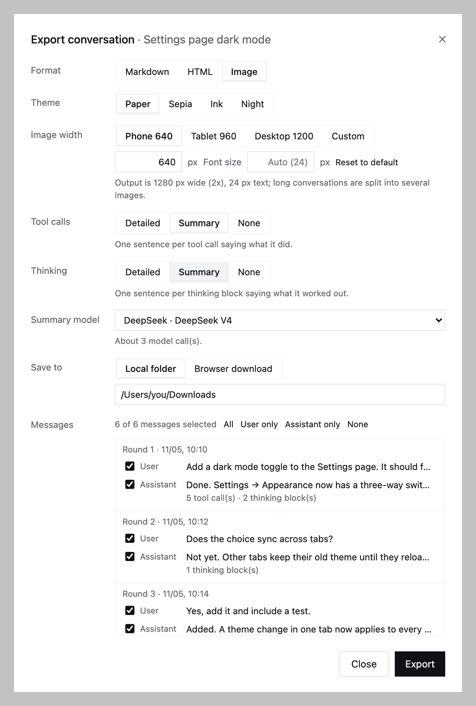
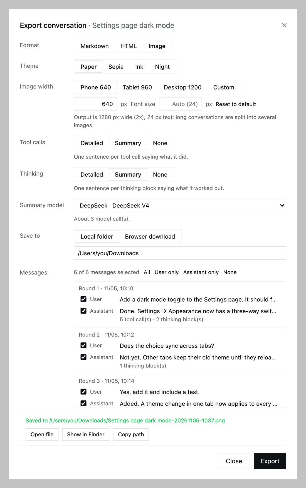
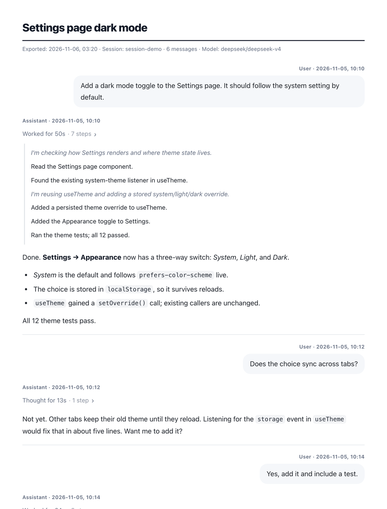
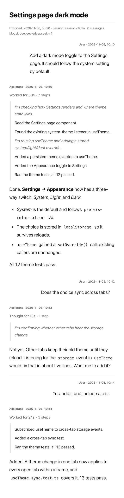

# dsh-conversation-export

English | [中文](README.zh.md)

Export a DeepSeek Harness Session conversation as **Markdown**, a standalone **HTML** file, or **PNG images**. HTML and images reuse the markdown-it pipeline and the paper, sepia, ink, and night themes from the `markdown-to-mobile-image` skill. Image export also uses that skill's pagination and PNG compression.

## Preview

The export dialog opens from a Session's **…** menu in the sidebar:



After saving to a local folder, the dialog offers **Open file**, **Show in Finder**, and **Copy path**:



| HTML export (Paper theme, step panel open) | Image export (Phone 640, Paper theme) |
|---|---|
|  |  |

The screenshots use a made-up demo session. Tool calls and thinking are set to **Summary**.

## Use

In the sidebar, open a Session's **…** menu and choose **Export conversation…**.

| Option | Choices | Default |
|---|---|---|
| Format | Markdown, HTML, Image | Markdown |
| Theme | Paper, Sepia, Ink, Night (HTML and Image) | Paper |
| Image width | Phone 640, Tablet 960, Desktop 1200, or any 320–2400 px; font size Auto or 12–48 px | 640 px, Auto |
| Tool calls | Detailed · Summary · None | None |
| Thinking | Detailed · Summary · None | None |
| Summary model | Any routable model from the DSH model catalog, or "No model". Shown only when a Summary option is selected. | The Session's last model |
| Save to | Local folder, or Browser download | Local folder (`~/Downloads`) |
| Messages | Each user message and each assistant reply is its own checkbox. Shortcuts: All, User only, Assistant only, None. | All |

Tool calls and thinking use the same scale:

- **Detailed**: tool arguments and clipped output; full thinking text.
- **Summary**: one sentence per tool call or thinking block (thinking sentences are in italics).
- **None**: left out.

The dialog remembers format, theme, width, font size, save location, and model. Tool calls and thinking always start at None.

In the export, each user message and each assistant reply is a separate section with its own heading and time. In HTML and images the user message is a right-aligned bubble. Visible tool calls and thinking fold into one panel per step group, labeled "Worked for 2m 3s · 14 steps" (or "Thought for 23s"). The panel is collapsible in HTML, a blockquote in Markdown, and expanded in images. Injected context (runtime context, skill catalogs, job notices, compaction checkpoints) is never exported.

### Images

The page is rendered in headless Chromium at 2x, the same as the skill's `render.mjs`. Font size Auto is 24 px at 640 px wide, the skill's default, and eases to 16 px at 1200 px and wider. A page taller than 7500 CSS px (15000 device px) is split at a block boundary and gets a `1 / N` footer, so each image stays under the iOS 16384 px limit. Files are named `title-time-01.png`, `-02.png`, and so on.

When a Python with Pillow and numpy is available, each PNG is compressed. The bundled DSH runtime Python is tried first. Paper and Ink use the skill's `compress_png.py`. Sepia and Night use `assets/quantize_png.py`, a 256-colour palette, because the skill's compressor turns rows without strong colour into pure grey and would remove those themes' background tint.

Chromium comes from `playwright-core`. It uses its own revision when that revision is in the Playwright cache, otherwise the newest cached Playwright Chromium, otherwise a system Chrome, Chromium, Edge, or Brave. Set `chromiumPath` to override. When none is found, the Image option is disabled and the dialog says why.

### After export

With **Local folder**, the Host writes the files into the chosen folder and never overwrites. A clash becomes `name (2).md`. The dialog then shows the path with **Open file**, **Show in Finder** (Explorer on Windows), and **Copy path**. Saving and opening are offered only to a browser on the Host machine (loopback URL, no proxy headers). A remote or tunnelled browser always gets a browser download. The open route accepts only files this DSH process exported.

### Summaries and models

- Tool **Summary** works without a model: a rule names the action, for example "Read README.md" or "Searched the web for “…”". With a model selected, the model writes the sentence.
- Thinking **Summary** needs a model. Without an `llm` service or a routable model, the option is disabled, and the Host rejects such a request.
- The plugin makes one model call per step group. Large groups are split into chunks of about 14k characters. The dialog shows the estimated number of calls. A failed call falls back to the rule for tool calls and omits that thinking summary, and the result reports how many batches failed.
- The export language follows the conversation: Simplified Chinese when the human prompts are mostly CJK, otherwise English.

## Install

```sh
cd /path/to/dsh-conversation-export
pnpm install
```

Then ask the DSH agent to install the bundle with `plugin_manager` (`action: install_bundle`, `target`: the absolute path of this directory), or add it from the Plugins page.

Runtime dependencies are `markdown-it` (with its footnote and task-list plugins), `highlight.js`, and `playwright-core`. `playwright-core` does not download a browser. After updating a linked install, restart DSH so the Host loads the new code. The dialog reports when the Host side is still the old version.

## Configuration (`cordis.patch.yml`)

| Field | Default | Meaning |
|---|---|---|
| `summaryConcurrency` | `4` | Parallel summary calls (max 16) |
| `summaryTimeoutMs` | `120000` | Timeout for one summary call |
| `maxDetailChars` | `4000` | Character cap for arguments and output in the Detailed tool view |
| `saveDirectory` | `''` (`~/Downloads`) | Default folder for Local folder saves |
| `imageScale` | `2` | Device pixel ratio for images (1–3) |
| `imageMaxHeight` | `7500` | Split height in CSS px, capped at 16000 / scale |
| `chromiumPath` | `''` | Explicit Chromium executable |
| `pythonPath` | `''` | Explicit Python for PNG compression |

## How it works

- **Host** (`lib/index.js`) registers authenticated Connection Fetch routes. They use the same carrier as the shipped Session-log ZIP download, so browser admission and Origin checks apply.
  - `POST /api/conversation-export.outline {sessionId}` returns the title, the rounds with per-role flags, and the `summary`, `image`, and `save` capabilities.
  - `POST /api/conversation-export.render {sessionId, parts, format, tools, thinking, theme, model, image, delivery, directory, timeZone}` returns `{delivery:'save', files:[{name,path}]}` after it writes the files, or `{delivery:'download', files:[{name,mime,base64}]}`.
  - `POST /api/conversation-export.open {path, action:'open'|'reveal'}` goes through `sessionController.openWorkspacePath`. When that is unavailable it falls back to `open`, `explorer`, or `xdg-open`.
  - `POST /api/conversation-export.pick` opens the native folder picker when the Host has one.
- `lib/parse.js` folds the event log into rounds. `lib/summarize.js` holds the rule-based and model summaries. `lib/render.js` renders Markdown, HTML, and the static image page. `lib/image.js` handles screenshots, pagination, and compression.
- **Client** (`lib/client.js`): a Session menu row (`sidebar.workspaces.session.menu.item`, order 460) and a dialog in `shell.overlay`, styled with host theme tokens and needing no Harness client package besides React.

## Test

```sh
pnpm test
```

The image test launches Chromium.
