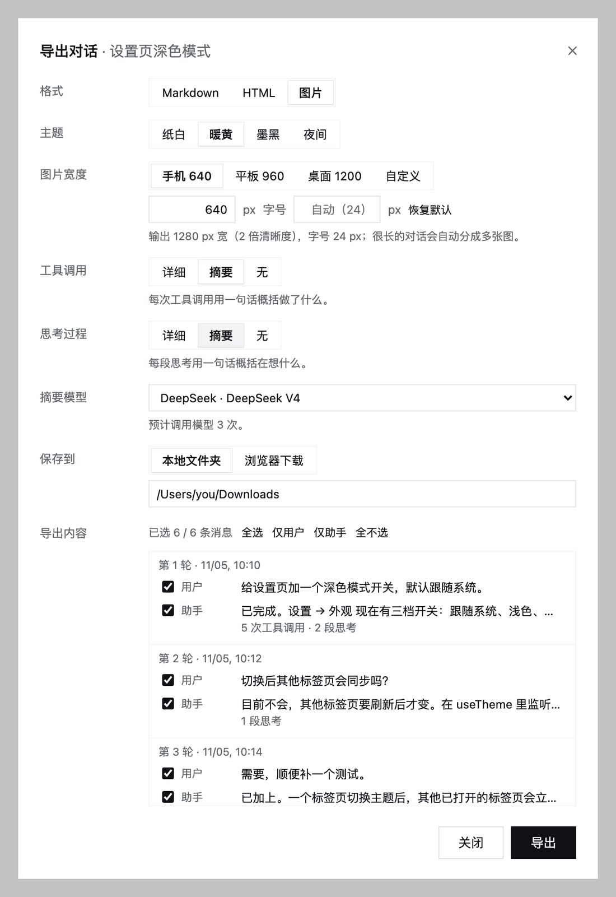
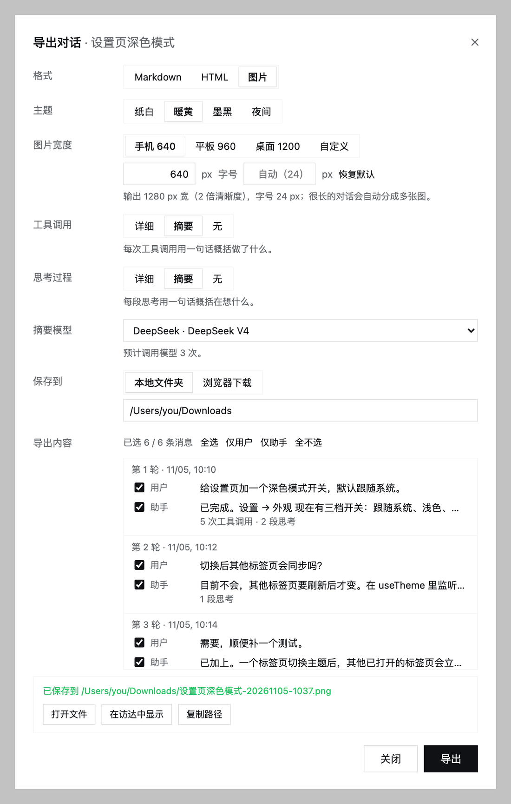
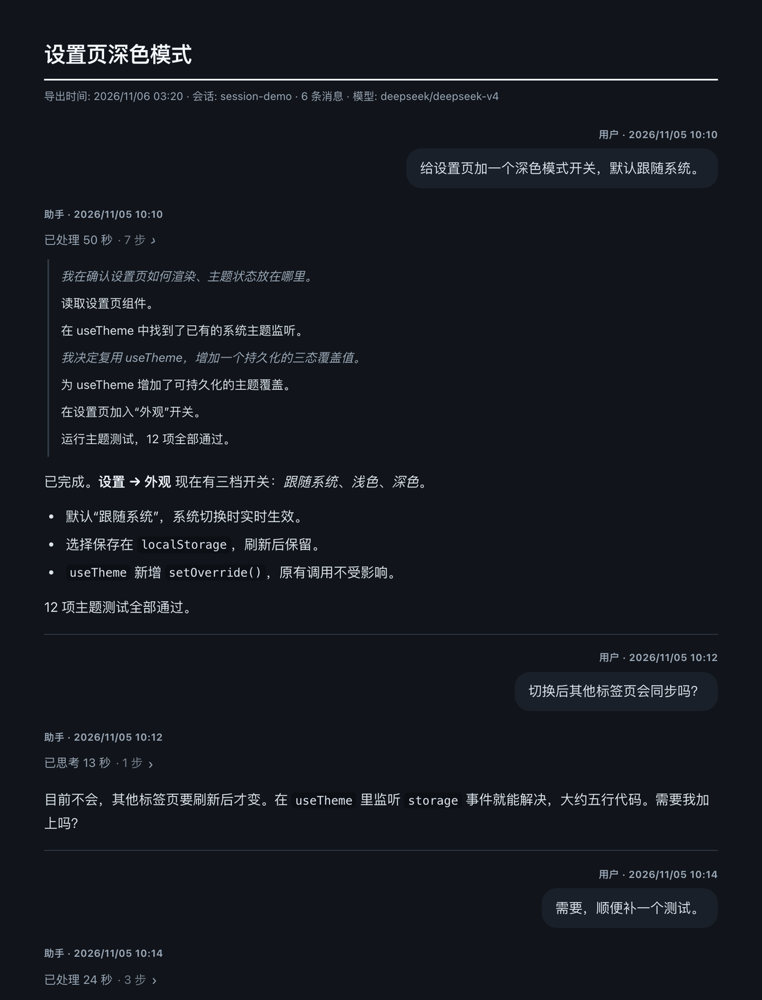
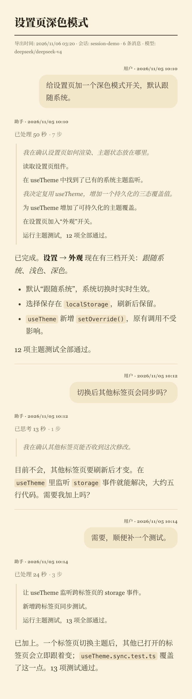

# dsh-conversation-export

[English](README.md) | 中文

把 DeepSeek Harness 的会话导出为 **Markdown**、独立的 **HTML** 文件或 **PNG 图片**。HTML 和图片沿用 `markdown-to-mobile-image` 技能的 markdown-it 渲染方式和纸白、暖黄、墨黑、夜间四套主题；图片导出还沿用了它的分页和 PNG 压缩。

## 预览

在左侧会话列表里，点开某个会话的 **…** 菜单即可打开导出对话框：



保存到本地文件夹后，对话框里可以直接 **打开文件**、**在访达中显示** 或 **复制路径**：



| HTML 导出（夜间主题，展开步骤面板） | 图片导出（手机 640，暖黄主题） |
|---|---|
|  |  |

截图用的是一个虚构的演示会话，工具调用和思考过程都设为 **摘要**。

## 使用

在左侧会话列表里，打开会话的 **…** 菜单，选择 **导出对话…**。

| 选项 | 可选值 | 默认 |
|---|---|---|
| 格式 | Markdown、HTML、图片 | Markdown |
| 主题 | 纸白、暖黄、墨黑、夜间（HTML 和图片） | 纸白 |
| 图片宽度 | 手机 640、平板 960、桌面 1200，或 320–2400 px 之间任意值；字号为自动或 12–48 px | 640 px，自动 |
| 工具调用 | 详细 · 摘要 · 无 | 无 |
| 思考过程 | 详细 · 摘要 · 无 | 无 |
| 摘要模型 | DSH 模型目录中任意可用的模型，或“不使用模型”。只有选了“摘要”时才显示。 | 该会话最后使用的模型 |
| 保存到 | 本地文件夹，或浏览器下载 | 本地文件夹（`~/Downloads`） |
| 导出内容 | 每条用户消息和每条助手回复各有一个复选框；快捷按钮：全选、仅用户、仅助手、全不选 | 全选 |

工具调用和思考过程使用同一套三档：

- **详细**：工具调用保留参数和截断后的输出；思考过程保留全文。
- **摘要**：每次工具调用、每段思考各用一句话概括（思考的那句用斜体）。
- **无**：不显示。

对话框会记住格式、主题、宽度、字号、保存位置和模型；工具调用和思考过程每次都从“无”开始。

导出结果里，每条用户消息和每条助手回复都是独立的一节，各有自己的标题和时间。HTML 和图片中，用户消息显示为靠右的气泡。显示出来的工具调用和思考过程会按步骤组折叠成一个面板，标题如“已处理 2 分 3 秒 · 14 步”（只有思考时为“已思考 23 秒”）：HTML 中可点击展开，Markdown 中是引用块，图片中直接展开。运行环境、技能列表、后台任务通知、压缩检查点等系统注入的内容不会导出。

### 图片

页面在无头 Chromium 中以 2 倍清晰度渲染，与技能的 `render.mjs` 一致。字号“自动”在 640 宽时为 24 px（技能默认值），宽度越大字号越小，1200 及以上为 16 px。页面高于 7500 CSS px（15000 设备像素）时，会在段落边界分页，并在底部标注 `1 / N`，保证每张图都低于 iOS 的 16384 像素上限。文件名为 `标题-时间-01.png`、`-02.png` 等。

有带 Pillow 和 numpy 的 Python 时，会压缩每张 PNG，优先使用 DSH 自带的运行时 Python。纸白和墨黑用技能的 `compress_png.py`；暖黄和夜间用 `assets/quantize_png.py`（256 色调色板）。原因是技能的压缩脚本会把没有明显颜色的行变成纯灰，会去掉这两套主题的底色。

Chromium 由 `playwright-core` 启动：Playwright 缓存里有它对应的版本时用该版本，否则用缓存中最新的 Playwright Chromium，再否则用系统的 Chrome、Chromium、Edge 或 Brave。可用 `chromiumPath` 指定。都找不到时，“图片”选项不可用，对话框会说明原因。

### 导出之后

选择 **本地文件夹** 时，Host 把文件写入所选文件夹，不会覆盖已有文件，同名时改为 `名称 (2).md`。对话框随后显示路径，并提供 **打开文件**、**在访达中显示**（Windows 为资源管理器）和 **复制路径**。保存和打开只对 Host 本机的浏览器开放（回环地址、没有代理转发头）；远程或经隧道访问时一律走浏览器下载。“打开”只接受本次 DSH 进程导出过的文件。

### 摘要与模型

- 工具调用的 **摘要** 不需要模型：不选模型时按规则生成，如“读取 README.md”“联网搜索“…””；选了模型则由模型写这句话。
- 思考过程的 **摘要** 必须有模型。没有 `llm` 服务或没有可用模型时，该选项不可用，Host 也会拒绝这类请求。
- 每个步骤组调用一次模型，内容过多时按约 1.4 万字符分块。对话框会显示预计调用次数。某次调用失败时，工具调用改用规则生成，对应的思考摘要省略，结果里会报告失败批数。
- 导出语言跟随对话：用户消息以中日韩文字为主时用简体中文，否则用英文。

## 安装

```sh
cd /path/to/dsh-conversation-export
pnpm install
```

然后让 DSH 智能体用 `plugin_manager` 安装（`action: install_bundle`，`target` 为本目录的绝对路径），或在插件页面添加。

运行时依赖为 `markdown-it`（及其脚注、任务列表插件）、`highlight.js` 和 `playwright-core`；`playwright-core` 不会下载浏览器。更新以链接方式安装的版本后，请重启 DSH，让 Host 加载新代码；如果 Host 还是旧版本，对话框会提示。

## 配置（`cordis.patch.yml`）

| 字段 | 默认 | 含义 |
|---|---|---|
| `summaryConcurrency` | `4` | 摘要并发调用数（最多 16） |
| `summaryTimeoutMs` | `120000` | 单次摘要调用的超时时间 |
| `maxDetailChars` | `4000` | “详细”工具调用中参数和输出的字符上限 |
| `saveDirectory` | `''`（`~/Downloads`） | “本地文件夹”的默认位置 |
| `imageScale` | `2` | 图片的设备像素比（1–3） |
| `imageMaxHeight` | `7500` | 分页高度（CSS px），上限为 16000 / 倍数 |
| `chromiumPath` | `''` | 指定 Chromium 可执行文件 |
| `pythonPath` | `''` | 指定用于压缩 PNG 的 Python |

## 实现

- **Host**（`lib/index.js`）注册经过认证的 Connection Fetch 路由，与内置的会话日志 ZIP 下载使用同一通道，因此同样经过浏览器准入和 Origin 检查。
  - `POST /api/conversation-export.outline {sessionId}`：返回标题、带角色标记的轮次，以及 `summary`、`image`、`save` 三项能力。
  - `POST /api/conversation-export.render {sessionId, parts, format, tools, thinking, theme, model, image, delivery, directory, timeZone}`：写入文件后返回 `{delivery:'save', files:[{name,path}]}`，或返回 `{delivery:'download', files:[{name,mime,base64}]}`。
  - `POST /api/conversation-export.open {path, action:'open'|'reveal'}`：通过 `sessionController.openWorkspacePath` 打开；不可用时改用 `open`、`explorer` 或 `xdg-open`。
  - `POST /api/conversation-export.pick`：Host 支持时打开系统的文件夹选择器。
- `lib/parse.js` 把事件日志拆成轮次；`lib/summarize.js` 负责规则摘要和模型摘要；`lib/render.js` 生成 Markdown、HTML 和图片用的静态页面；`lib/image.js` 负责截图、分页和压缩。
- **Client**（`lib/client.js`）：会话菜单项（`sidebar.workspaces.session.menu.item`，order 460）和 `shell.overlay` 中的对话框，使用宿主主题变量，除 React 外不依赖其他 Harness 客户端包。

## 测试

```sh
pnpm test
```

图片测试会启动 Chromium。
